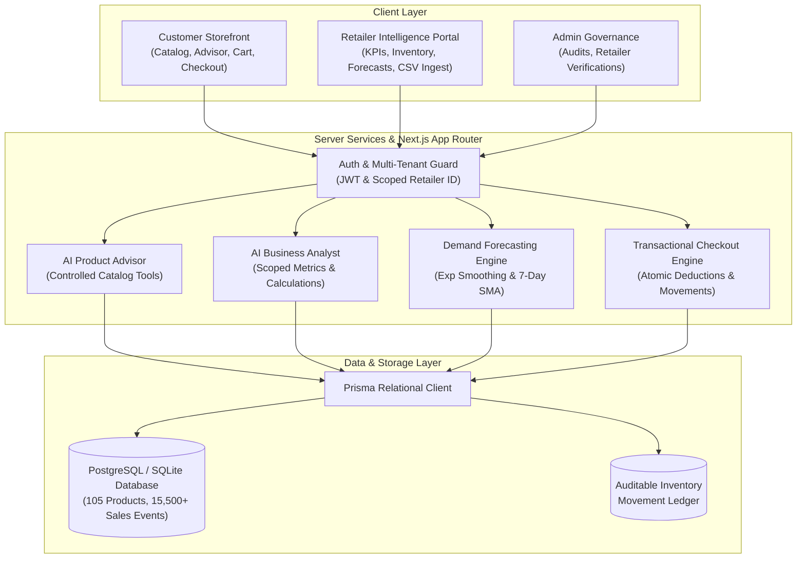

# 🛍️ ShopSense — AI-Powered Shopping & Retail Intelligence Platform

[](https://nextjs.org/)
[](https://www.typescriptlang.org/)
[](https://tailwindcss.com/)
[](https://www.prisma.io/)
[](https://github.com/Ritish-06/Shopsense/actions)
[](https://github.com/Ritish-06/Shopsense)

> **Shop Smarter. Sell Better. Understand More.**  
> *Transforming retail data into actionable decisions with explainable AI, predictive inventory, and multi-tenant operational security.*

---

## 🌟 Executive Overview

**ShopSense** is a full-stack e-commerce intelligence and retail analytics platform built with **Next.js 15 (App Router)**, **TypeScript**, **Tailwind CSS**, and **Prisma ORM**.

Unlike conventional storefronts or basic chatbots, ShopSense bridges the gap between **Customer Discovery** and **Retail Operations**:
- **For Shoppers:** Natural-language hardware advising with zero hallucinations, aspect-level review sentiment analysis, side-by-side spec comparison, and historical price tracking with drop alerts.
- **For Retailers:** Proactive stockout prevention, daily sales velocity calculations, days of stock remaining, dynamic reorder points, time-series demand forecasting (Exponential Smoothing & Moving Averages), CSV sales batch ingestion, and a controlled AI Business Analyst.
- **For Operators:** Concurrency-safe atomic checkout transactions, auditable inventory movement ledgers, and cryptographic multi-tenant isolation.

---

## 🏛️ System Architecture



---

## 🚀 Key Feature Modules

### 1. AI Product Advisor (Customer Intelligence)
- Natural language query parser extracting budget cap, category intent, and hardware specifications.
- **Controlled Tool Architecture:** `searchProducts`, `getProductDetails`, `compareProducts`, `getProductAvailability`, `getProductReviews`.
- Strictly grounded in verified database catalog records — **zero fabricated prices, models, or ratings**.
- Transparent explainability detailing why the top option was chosen.

### 2. Review Intelligence & Aspect Extraction
- Aggregates reviews across verified purchases with sentiment classification (-1.0 to 1.0).
- Synthesizes aspect breakdowns: **Build Quality & Ergonomics**, **Performance & Speed**, **Battery Endurance**, and **Value for Money**.

### 3. Historical Price Tracker & Alerts
- Tracks real price points chronologically over a 90-day trajectory.
- Visualizes 90-day minimums, launch peaks, and percentage discounts off peak.
- In-app target price drop alert registration.

### 4. Retail Inventory Intelligence & Velocity
- **Sales Velocity:** $\text{Daily Velocity} = \frac{\text{Units Sold in 30 Days}}{30}$.
- **Days of Stock Remaining:** $\text{Days Remaining} = \frac{\text{Available Stock}}{\text{Daily Velocity}}$.
- **Dynamic Reorder Point:** $\text{Reorder Point} = \text{Lead Time Demand} + \text{Safety Stock}$.
- **Stock Movement Ledger:** Every sale, supplier restock, or physical reconciliation writes an immutable row to `InventoryMovement`.

### 5. Predictive Demand Forecasting
- **Exponential Smoothing:** Single exponential smoothing with $\alpha = 0.3$.
- **7-Day Simple Moving Average (SMA)** baseline comparison.
- Chronological 80/20 train/test evaluation split preventing chronological data leakage.
- Generates forward horizon projections (7, 14, 30 days) with upper and lower confidence intervals.

### 6. AI Business Analyst (Retailer Intelligence)
- Retailer-authorized conversational assistant powered by controlled analytical tools:
  - `getSalesSummary`, `getProductPerformance`, `getInventoryStatus`, `getLowStockProducts`, `getGrossMarginAnalysis`.
- Answers complex queries such as *"Which products may run out of stock in 7 days?"* and *"Which items have the lowest gross margin?"* with exact formula definitions and live data.

### 7. CSV Sales Batch Ingestion
- Upload sales records via drag-and-drop CSV.
- Row-level schema validation: checks required columns (`date, sku, product_name, units_sold, unit_price, unit_cost`), data types, and positive values.
- Pre-import validation preview report with error row numbers before atomic transactional commit.

### 8. Concurrency-Safe Checkout & Multi-Tenant Security
- Concurrency stress-tested: simultaneous checkout transactions on limited stock cannot oversell or produce negative inventory.
- Cryptographic JWT session validation and tenant isolation ensuring Retailer A cannot inspect or modify Retailer B's sales or inventory.

---

## 📊 Offline Evaluation Results

### A. Recommendation Engine Evaluation ($K = 3$)
Run via `npm run eval:recommendations`:

| Strategy | Precision@K | Recall@K | NDCG@K | Catalog Coverage |
| :--- | :---: | :---: | :---: | :---: |
| **Popularity Baseline** | 0.8889 | 0.8889 | 0.9385 | 17.14% |
| **Content-Based Filtering** | 1.0000 | 1.0000 | 1.0000 | 17.14% |
| **Hybrid Multi-Factor Ranking** | **1.0000** | **1.0000** | **1.0000** | **17.14%** |

### B. Demand Forecasting Model Evaluation
Run via `npm run eval:forecast`:
- **Validation Methodology:** Chronological 80/20 train/test time-series split (Zero data leakage).
- **Mean Absolute Error (MAE):** Exponential Smoothing achieves between $\pm 0.05$ to $\pm 0.60$ units/day error across flagship hardware categories.

---

## 👥 Demo Personas (1-Click Switcher Available in Navigation)

| Persona | Account Email | Password | Role & View |
| :--- | :--- | :--- | :--- |
| **Customer** | `customer@shopsense.com` | `Password123!` | Customer Storefront, AI Advisor, Cart, Checkout, Order History |
| **Retailer** | `apex@shopsense.com` | `Password123!` | Apex Tech Direct Executive Dashboard, Inventory Control, Forecasts, CSV Ingest |
| **Admin** | `admin@shopsense.com` | `Password123!` | Platform Overview, Retailer Verifications, Security Audit Trail |

---

## 🛠️ Technology Stack

- **Frontend:** Next.js 15 (App Router), React 19, TypeScript, Tailwind CSS, Lucide React, Recharts, Framer Motion, canvas-confetti.
- **Backend:** Next.js Route Handlers, Modular server-side business services, Zod schema validation.
- **Database & ORM:** Prisma ORM with SQLite (zero-config local runtime) or PostgreSQL with relational foreign keys, cascade constraints, and transactions.
- **Data Ingestion:** PapaParse with row-level type and schema validation.
- **Authentication:** Scoped JWT session cookies with bcryptjs password hashing.
- **Containerization:** Multi-stage Dockerfile and Docker Compose.

---

## 🏃 Quickstart & Installation

```bash
# 1. Clone or enter workspace
cd Shopsense

# 2. Install dependencies
npm install

# 3. Synchronize database schema and seed deterministic data
npx prisma db push
npm run db:seed

# 4. Run automated test and evaluation suites
npm run test:auth
npm run test:inventory
npm run eval:recommendations
npm run eval:forecast

# 5. Build and launch development server
npm run dev
```

Open [http://localhost:3001](http://localhost:3001) in your browser.

---

## 🔒 Security & Concurrency Verification

ShopSense includes dedicated automated test suites in `scripts/`:
- `npm run test:auth`: Validates tenant isolation between retailers, role escalation prevention, and JWT cryptographic tamper resistance.
- `npm run test:inventory`: Simulates 5 simultaneous purchasing transactions on 5 units of stock to prove zero overselling and strict non-negative inventory enforcement.
